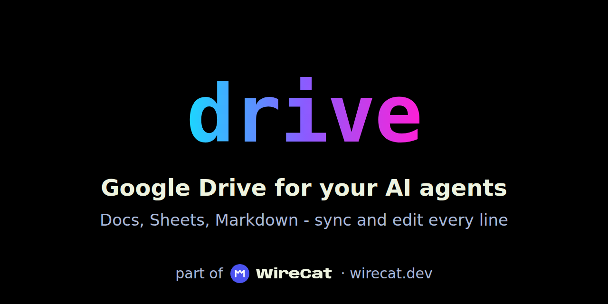

<p align="center">
  
</p>

# drive: Google Drive and Docs for AI agents

<p align="center">
  Your agent edits a Google Doc a few lines at a time, from a Markdown file on your computer, while your colleagues
  keep writing and commenting in it. For you and for Claude Code, Codex or any app that speaks MCP.
</p>

<p align="center">
  <a href="https://wirecat.dev/en/docs/drive">Docs</a> ·
  <a href="https://github.com/WireCatLabs/drive-cli/blob/main/docs/installation.md">Install</a> ·
  <a href="https://github.com/WireCatLabs/drive-cli/blob/main/docs/usage.md">Usage</a> ·
  <a href="https://discord.gg/DebENqbRrJ">Discord</a>
</p>

<p align="center">
  <a href="https://www.npmjs.com/package/@wirecat/drive-cli"></a>
  <a href="https://github.com/WireCatLabs/drive-cli/actions/workflows/ci.yml"></a>
  <a href="https://www.npmjs.com/package/@wirecat/drive-cli"></a>
  <a href="https://github.com/WireCatLabs/drive-cli/blob/main/LICENSE"></a>
</p>

- **Edit a Google Doc block by block.** You or your agent change a local Markdown file with any editor or the agent's
  usual file edit. `drive personal mirrors sync` sends only the changed blocks, such as a paragraph or a list item, to the Doc.
  Comments on the text you left alone stay where they are.
- **Your colleagues' edits are kept.** What they changed in other parts of the Doc comes back into your file. A part
  changed on both sides is reported with both versions, never silently written over.
- **Search your Drive with sources.** Import the folders you choose, then search them on your computer by words or by
  meaning. Every result links to the original Google file.

## What you get

- **An agent that edits like a careful colleague.** It changes the two lines you asked about. The rest of the Doc, and
  the comments on it, stay as they were.
- **Changes from Google land in your file.** A colleague's edit comes back on the lines it touched. Your own `*`
  bullets and code fences stay as you wrote them.
- **Conflicts you can see.** When the same paragraph changed in the file and in Google, sync shows both versions, who
  changed it in Google and when. You choose with `--keep local`, `--keep google` or `--keep both`.
- **Hands-free sync.** `drive personal mirrors watch` syncs on each save and asks Google for changes every minute.
- **Answers with their source.** "What did we decide about the Q4 budget?" returns the passage and the link to the
  Doc it came from.

```text
You:    In plans/q4.md, rewrite the Risks section around the vendor delay. Leave the rest.
Agent:  (edits 3 lines under "## Risks" in plans/q4.md)
        (runs drive personal mirrors sync: 1 file sent, 1 pulled)
        The Risks section is updated in the Google Doc. Dana Example changed the Timeline in Google
        meanwhile, so her edit is now in your file too.
```

## Why drive

- **Small edits instead of a new copy.** Google lets programs change a Markdown file in Drive only by replacing all of
  it ([measured](https://github.com/WireCatLabs/cli-testing/tree/main/performance/documents/native-markdown)). A
  replace writes the agent's copy over the whole file, so an edit a colleague made after the agent read it is lost.
  drive keeps a real Google Doc in step with your file and sends small edits next to theirs. Google refuses an edit
  from drive if the Doc changed after drive read it, so nothing is written over.
- **What your agent gets that a plain Drive connector does not give.** Claude's built-in Google Drive connector can
  create a new file and change a file's title or folder, but not its text (its `update_file` tool, checked
  on 2026-11-17). With drive, the agent edits the text itself.
- **Word, Excel and text files in Drive edited in place.** `files sheets update` changes cells of an uploaded `.xlsx`,
  `files documents update` paragraphs of a `.docx`, and `files update` the text of a Markdown or CSV file. Each
  write needs the `sha256` the file was read at and keeps the replaced content on your computer
  ([edit a file stored in Drive](docs/usage.md#edit-a-file-stored-in-google-drive)).
- **Search that stays on your computer.** Google Docs are read across all their tabs, and a document keeps its identity
  through renames and moves. Keyword search and optional local embeddings come from WireCat's shared search.
- **Safe to give to an agent.** Reads are the default. Changes in Google need a sign-in with `--grant write`, and
  `DRIVE_READ_ONLY=1` refuses every change.
- **Free and open source.** Apache 2.0, built on Google's official Node clients.

How it compares with gog, Workspace MCP and rclone, and when another tool fits better:
[compared with other tools](docs/compare.md).

## Quick start

```sh
npm install -g @wirecat/drive-cli
drive personal session start --grant write
drive personal mirrors add ./notes --parent https://drive.google.com/drive/folders/FOLDER_ID
drive personal mirrors sync
```

`personal` is a name you choose for this Google account. The first sync turns each `.md` file in `./notes` into a
Google Doc in that folder. Edit a file, run `mirrors sync` again, and only what changed reaches the Doc. The full
guide, with CSV files as Sheets and what happens on a conflict: [mirror local files with Google](docs/mirrors.md).

You need Node 22.16+ on the 22.x line or Node 24+. See [installation and Google connection](docs/installation.md).
Source builds are for [contributors](docs/dev/DEVELOPMENT.md).

`drive doctor` shows the version, settings file, profiles and paths without signing in, and `drive upgrade`
installs a newer version with the package manager that installed drive.

## Use it with your agent

Ask in plain words. The agent picks the commands.

> *"Use drive. Tighten the intro of notes/launch.md and sync it to the Doc."*
> *"Use drive. Find what we decided about the vendor contract, with the link."*

- **Claude Code, Codex** and other agents with a terminal edit the Markdown file with their usual file tools and run
  `drive` themselves. `drive skill install` puts drive's instructions where Claude Code, Codex, Gemini CLI and
  OpenClaw look (Hermes with `--for hermes`).
- **Apps that speak MCP** connect to `drive personal mcp serve`. It serves three tools (search, read, write), and
  an agent can run `mirrors sync` through them. `mirrors watch` runs only from the command line.
- **ChatGPT and Claude in the browser** reach it with `--http` ([remote MCP](docs/remote.md)).

`drive guide` lists scenarios, the commands for a common task in order, and `drive commands --json` is the full
command tree. `DRIVE_READ_ONLY=1` refuses every change, as `--read-only` does.

More: [recipes](https://github.com/WireCatLabs/drive-cli/blob/main/docs/recipes.md)

## Sign in and choose folders

Sign in with WireCat's included Google application. Each user approves their own account in the
browser. Making a shared Google application public for Drive is complex, so Google may refuse
the sign-in. See [what to do](docs/installation.md#google-shows-an-unverified-app-warning).
You can also create your own Desktop client as explained in the
[installation guide](docs/installation.md). Connect your account, then choose a folder to import for search:

```sh
drive personal session start
drive personal folders add https://drive.google.com/drive/folders/FOLDER_ID
drive personal sync --json
```

For Google Cloud setup and an isolated first run, follow the
[browser sign-in and live validation guide](docs/dev/GOOGLE_OAUTH.md).

Sign-in opens the system browser and receives Google's callback on a temporary loopback port.
`--no-browser` prints the URL. `drive.readonly` grants account-wide reading, and our selected-folder
scope limits ingestion. Sync reads remote files. Mirrors and other remote changes need a
new sign-in with `session start --grant write`, and history events need `session start --grant activity`.

Credentials use the OS keyring. Where it fails, drive uses an owner-only private file without
asking and says so once. `--credential-storage file` chooses the file outright, not recommended. Tokens never enter
regular config, output or diagnostics. Your own Google app replaces the bundled one with `session start --client-file`
or `--client-id`, `DRIVE_GOOGLE_CLIENT_ID` and `DRIVE_GOOGLE_CLIENT_SECRET`, or the `google_client_id` setting, in that
order. The included Desktop client identity is public application metadata, separate from private user tokens. If you
create your own Desktop client and leave it in Testing, Google usually ends its sign-ins after seven days.
[Google OAuth guide](https://developers.google.com/identity/protocols/oauth2/native-app),
[Drive permissions](https://developers.google.com/workspace/drive/api/guides/api-specific-auth).

Use `drive work …` for another account. Each Google account has one local profile. `drive session list`
lists configured profiles. `session end` removes local sign-in while retaining cached data and
configuration so re-login preserves document identities. `account remove --keep-data` or `--delete-data` goes
further. It revokes the sign-in at Google and forgets the profile, and `--delete-data` also deletes its snapshots.

Sources supported for import now: native Google Docs and Sheets, PDF, docx, xlsx, CSV, TSV, and uploaded
Markdown or TXT. Other types and shortcuts are reported as skipped, and shortcuts are not followed outside the
selected scope.

## Search and export

```sh
drive personal search 'budget decision' --json
drive personal search 'budget' --exact --json
drive personal documents list --json
drive personal documents show DOC_ID --json
drive personal documents export DOC_ID --output ./document.md
drive personal status --json
drive commands sync --json
```

Search results include the original Google URL. `documents show`, `list` and `export` print `synced_at` and
`age_days`. A copy older than a day adds `missing`, `next` and `meta.complete: false`. `documents show` includes each
tab's text, ID and title. Native Markdown exports are saved separately from the all-tab text used for indexing.
Export refuses to overwrite an existing destination file.

Semantic search uses the shared local text model (about 135 MB). Download it once. It needs no profile or sign-in,
and every WireCat CLI shares it:

```sh
drive models download e5-small
drive personal sync --embed
```

Drive never downloads a model on its own, and a missing one is reported. `--exact` searches words without semantic
retrieval.

## Keep it current

```sh
drive personal sync --limit 200 --json
drive personal folders remove FOLDER_ID
drive personal sync --json
```

A batch is persisted before processing, and interrupted work resumes next run. Progress is saved
every 25 files or 2 seconds, so a killed sync redoes at most that many. The first walk of the
chosen folders is saved as it goes, and an interrupted walk continues from the folders it had not
listed yet. The change cursor advances when the batch completes. Incomplete discovery preserves the prior checkpoint and
documents. A per-profile heartbeat lock prevents simultaneous syncs and recovers after crashes.

Confirmed removals and scope exits remove sources from search and delete their snapshots.
Removing the last selected folder reconciles to an empty cache on the next sync. Unsupported,
restricted and oversized sources have explicit coverage status. Transient failures remain pending,
and a partial sync with errors exits nonzero. Doc IDs, rather than names, distinguish duplicates.

## Document knowledge and remote actions

```sh
drive personal tags add DOC_ID project-budget review
drive personal documents list tag:review
drive personal notes add DOC_ID 'Check the assumptions' --title Review
drive personal identities list DOC_ID
drive personal documents context DOC_ID
drive personal facts add DOC_ID 'Budget approved for Q4' --type decision --scope work
drive personal memories add DOC_ID 'Q4 budget, in short' --scope work --kind summary
drive personal memories extract DOC_ID --scope work
drive personal documents history DOC_ID
drive personal changes --since 7d
drive api list service:docs
```

Shared tags, notes, editor identities and evidence-backed memories stay attached to the imported documents.
AI extraction explicitly sends selected cached text to the configured model. It previews proposals
unless `--yes` is given. Saved proposals include source quotes, snapshot hashes and model authorship.
Use the shared model setup with `models set --provider openai --model MODEL_ID`. Provider keys
come from the corresponding API-key environment variable and never enter regular configuration.
Source content changes and scope removals mark source-backed memories stale. User notes stay local.

The generated API exposes 85 methods: 64 Drive, 17 Sheets, 3 Docs and 1 Activity. Convenient commands include
file listing, copying and moving, trash and restore, folder creation, Docs creation and batch updates, comments,
permissions, revisions and Shared Drives. Read grants remain the default. JSON API calls require
explicit flags for mutation and permanent deletion. Google still enforces file roles and API policy.

Read the [knowledge and API command guide](docs/dev/KNOWLEDGE_AND_API.md) for complete examples,
permissions, history limits, AI settings and supported request formats. Contributor checks use
isolated sources and mocked provider requests. See the [testing guide](docs/dev/TESTING.md).

## Storage and coverage

The shared path helper chooses platform-appropriate config, data and cache directories under
drive-cli. Override with `DRIVE_CONFIG_DIR`, `DRIVE_STATE_DIR` and `DRIVE_CACHE_DIR`. Snapshots are
`profiles/<profile>/documents/<file-id>.md` plus private JSON metadata and raw Docs responses.

Documents use the same local WireCat database as Memo, Telegram and MAX. Imports become searchable
across those tools, alongside messages and notes. `MESSAGING_STORE` selects another database, and
`WIRECAT_STATE_DIR` moves the default WireCat directory. Google sign-ins remain separate.

On first use after an upgrade, Drive rebuilds old document references from its managed snapshots,
without fetching Google. It retains the old database. If that database contains tags, notes,
memories, facts or relationships, Drive refuses to strand them. Keep using that file through
`MESSAGING_STORE` until those annotations are transferred.

Search covers body text, nested tables and footnotes from all tabs. Images, headers, footers,
comments and suggested edits are excluded. Image assets are not downloaded. Search text and Google’s native Markdown
export are separate representations. Inspect the export when layout or tab coverage matters.

One sync reads at most 10,000 entries under the chosen folders and saves where it stopped, and the next sync goes on
from there. A sync also stops after 15 minutes in a terminal, 45 seconds over MCP, and the next one goes on. One folder
may hold at most 10,000 entries, and one sync reads at most 10,000 changes from Google's change feed. Past either, it
stops with nothing lost and says what to do. Text caps at 2,000,000 characters and snapshots at 50 MiB, with bounded
pagination. Oversized input is refused rather than truncated. Google's native export also has its own 10 MB limit.
Documents changing during export remain pending for retry.

## Community

Questions and setup help: join the [WireCat Discord](https://discord.gg/DebENqbRrJ). Bugs go to this
repository's issues.
